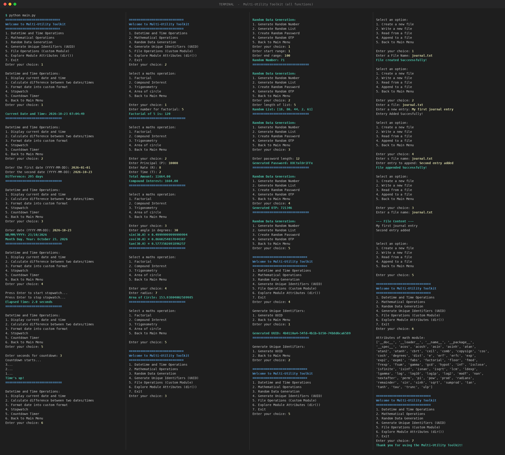

# 🧰 Multi-Utility Toolkit

---

## 📖 Project Description

**Multi-Utility Toolkit** is a menu-driven, command-line Python application that brings several everyday utilities together in one place. It is built using a **modular design** with a custom Python **package** (`my_package`), demonstrating how to organize code into reusable modules, import them, and run the program from a single entry point (`main.py`).

The project covers Python's built-in modules (`datetime`, `time`, `math`, `random`, `string`, `uuid`), file handling, exception handling, and module exploration with `dir()`.

---

## ✨ Features

### 🕒 Datetime and Time Operations
- Display the current date and time
- Calculate the difference between two dates
- Format a date into custom formats (`DD/MM/YYYY`, `Month Day, Year`)
- Stopwatch
- Countdown timer

### 🧮 Mathematical Operations
- Factorial of a number
- Compound interest calculator
- Trigonometric functions (sin, cos, tan)
- Area of a circle

### 🎲 Random Data Generation
- Random number within a range
- Random list of numbers
- Random password generator
- Random 6-digit OTP generator

### 🆔 Unique Identifiers
- Generate a unique UUID (version 4)

### 📁 File Operations (Custom Module)
- Create a new file
- Write to a file
- Read from a file
- Append to a file

### 🔍 Module Exploration
- Explore the attributes and functions of the `math` module using `dir()`

### 🛡️ Other Highlights
- Input validation and exception handling
- Clean, nested menu navigation with a "Back to Main Menu" option
- Modular code with a custom package

---

## 🛠️ Technologies Used

| Technology | Purpose |
|------------|---------|
| 🐍 **Python 3** | Core programming language |
| 💻 **VS Code** | Code editor / IDE |
| 🔧 **Git** | Version control |
| 🐙 **GitHub** | Code hosting and project sharing |

**Python modules used:** `math`, `datetime`, `time`, `random`, `string`, `uuid`

---

## 🚀 How to Run / Installation

### Prerequisites
- Python 3.x installed ([Download here](https://www.python.org/downloads/))
- Git installed (optional, for cloning)

### Steps

1. **Clone the repository**
   ```bash
   git clone https://github.com/<your-username>/<your-repo-name>.git
   ```

2. **Navigate to the project folder**
   ```bash
   cd <your-repo-name>
   ```

3. **Run the program**
   ```bash
   python main.py
   ```

> 💡 No external libraries are required — everything uses Python's standard library.

---

## 📂 Project Structure

```
├── main.py                  # Entry point with the main menu
├── README.md                # Project documentation
├── output.png               # Output Image
├── kajal.txt                # Created File 
└── my_package/              # Custom package
    ├── __init__.py          # Marks the folder as a Python package
    ├── all_operations.py    # Datetime, Math, Random & UUID operations
    └── file_operations.py   # File handling operations
```

---

## 🖥️ Output



---

## 👩‍💻 Author

**Kajal Mahato**

---


